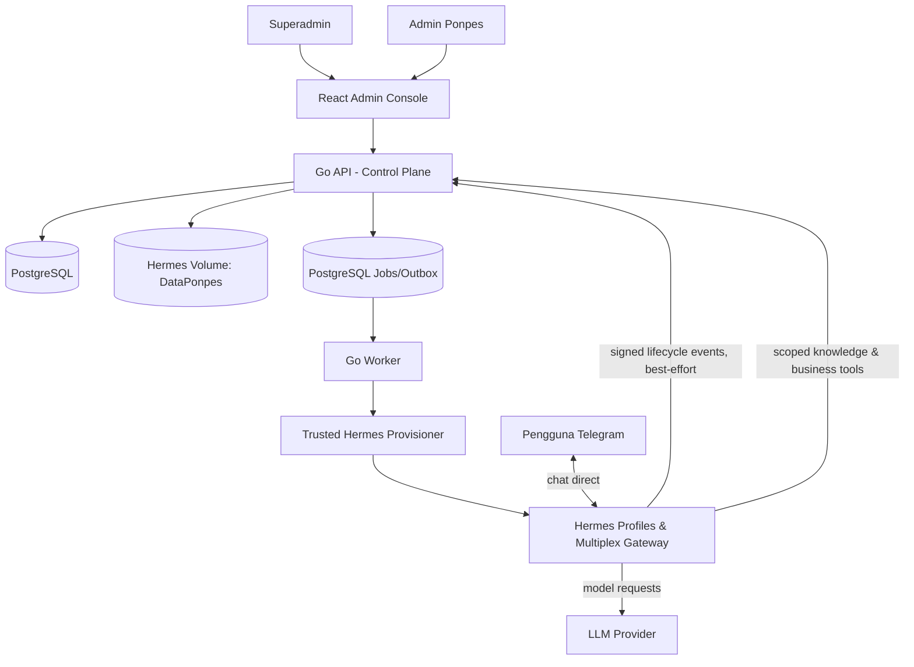

# 05 — Arsitektur sistem dan batas kepercayaan

## Prinsip arsitektur

1. **Go = control plane & source of truth bisnis**, bukan proxy wajib untuk setiap pesan Telegram.
2. **Hermes = AI runtime** yang menerima pesan Telegram, mengelola agent turns/session, dan menggunakan approved tools.
3. **Satu tenant ↔ satu Hermes Profile ↔ satu Telegram Bot**; identitas profile teknis berbasis UUID immutable.
4. **DataPonpes = file asli di volume filesystem Hermes** yang writable bagi Go storage service. PostgreSQL memegang indeks/metadata dan data bisnis saja.
5. **Batas tenant adalah kontrol backend/filesystem/container, bukan prompt**; profile saja memisah state Hermes tetapi bukan filesystem sandbox.
6. **Provisioner worker asinkron** diisolasi dari HTTP handler; tidak ada command shell arbitrary dari user.

## Diagram konteks

## Dua opsi deployment Hermes, serta tradeoff

### Opsi M — Multiplex Gateway (baseline MVP bersyarat)

- Satu gateway melayani beberapa profile dan token Telegram, biaya operasional relatif rendah.
- Pada **bot publik**, nonaktifkan `terminal`, `read_file`, `write_file`, `execute_code`, browser tool dan tool generik lain yang bisa menjangkau filesystem bersama; berikan hanya scoped tool API `search_tenant_documents` / `get_admission_info`.
- Files **tetap tersimpan di volume Hermes**; service Go membaca hanya subtree DataPonpes milik tenant pada backend tool, tidak membebaskan agent membuka path lain.
- Profil punya `SOUL.md` dan state terpisah, tetapi filesystem permission diperiksa di Go.
- **Blocker go-live:** dokumentasi Hermes menandai allow-all Telegram untuk developer; harus menguji pembatasan commands, auth, dan tool exposure secara konkret. Jika tidak aman, pakai Opsi C atau custom safe ingress sebelum publik.

### Opsi C — Container/runtime per tenant (lebih kuat untuk akses file langsung)

- Satu container Hermes per tenant, mount **hanya** `DataPonpes/{tenant_id}` ke `/workspace/DataPonpes` secara read-only. Admin tetap memakai Go file manager pada host/volume.
- Bisa mengizinkan native `read_file` dalam sandbox yang benar, dengan risiko resource/cost lebih tinggi dan orkestrasi tenant lebih kompleks.
- Cocok bila produk mengharuskan Hermes membaca dokumen langsung via file tools, OCR lokal, atau tenant berisiko tinggi.

**Aturan:** jangan menjalankan mode multiplex **dengan native filesystem tools tak-terbatas** dan menyebutnya tenant isolation. Keputusan final deployment dapat dinaikkan ke Opsi C jika P0 public security gate tidak bisa dibuktikan.

## Data flow utama

- **Onboarding:** React → Go API → DB transaction tenant+job → worker → provisioner → Hermes profile parked → verifikasi → activate.
- **Chat:** Telegram ↔ Hermes Profile; Hermes → scoped Go knowledge/admission API jika perlu; telemetry Hermes → Go receiver.
- **File:** Admin → Go File API → volume Hermes `DataPonpes/<uuid>` → metadata DB + extraction status → knowledge tersedia.
- **Analytics:** signed event → validated ingest → `ai_events`/usage; agregat dashboard dibangun async.

## SLO/keterikatan antar komponen

Jika API Go down, FAQ yang benar-benar local ke Hermes mungkin tetap berjalan; query via knowledge tool Go akan gagal dan bot harus abstain, bukan mengarang. Bila gateway down, Telegram tidak terlayani, tetapi admin dashboard tetap tersedia. Jaga failure domains terpisah.

## Prinsip version pinning

Pin release/commit Hermes, docker image digest dan schema migration. Run preflight terhadap CLI/features yang dipakai saat setiap upgrade.
