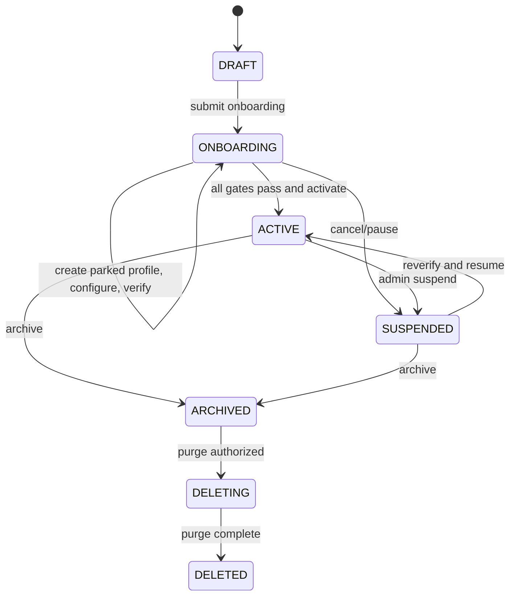

# 06 — Lifecycle tenant dan state machine

## Pisahkan tiga status

Jangan mencampur status bisnis, proses provisioning, dan kesehatan runtime dalam satu kolom:

- `tenants.lifecycle_status`: `DRAFT`, `ONBOARDING`, `ACTIVE`, `SUSPENDED`, `ARCHIVED`, `DELETING`, `DELETED`.
- `provisioning_runs.status`: `QUEUED`, `RUNNING`, `WAITING_INPUT`, `VERIFYING`, `SUCCEEDED`, `FAILED`, `CANCELLED`.
- `tenant_runtime.status`: `UNKNOWN`, `PARKED`, `HEALTHY`, `DEGRADED`, `OFFLINE` (observasi, bukan mutasi manual).

## Tahapan onboarding

Detail job stage (bukan status tenant): `RESERVE_IDENTITY` → `CREATE_PROFILE_PARKED` → `ENSURE_FOLDER` → `RENDER_CONFIG` → `WAIT_TELEGRAM_TOKEN` → `VALIDATE_BOT_ID` → `INSTALL_HOOKS_TOOLS` → `VERIFY_ROUTING` → `VERIFY_ISOLATION` → `ACTIVATE_GATEWAY` → `COMPLETE`.

## Invariant

1. Tenant `ACTIVE` mensyaratkan profile exists, bot unique+valid, knowledge isolation proven, public-bot access control verified, security gate marked passed.
2. Tenant `DRAFT/ONBOARDING/SUSPENDED` tidak dapat menerima chat publik (gateway parked atau ingress ditolak).
3. Nama profile teknis immutable, mis. `t_<uuid_no_dashes>`; slug tampilan ponpes boleh berubah.
4. Satu active provisioning run per tenant; operasi retry aman terhadap stage sebelumnya.
5. Aktivasi bukan sekadar mengubah DB `status`; harus memastikan runtime benar-benar aktif/healthy.
6. Suspend cepat, idempoten dan menghasilkan audit; tool mutasi bisnis ditolak segera bahkan sebelum parking selesai.

## Perubahan dan failure handling

| Kasus | Reaksi otomatis | Operator |
|---|---|---|
| Create profile berhasil, DB timeout | Retry `describe` lalu adopt existing expected profile | Intervensi hanya jika mismatch metadata |
| Profile sudah ada milik tenant lain | `FAILED_SECURITY`, fail closed | Manual inspect |
| Bot token invalid | WAITING_INPUT, jangan aktif | Admin ganti token |
| Bot ID sama dengan tenant lain | 409 + audit | Revoke/reconnect |
| Hermes CLI tak tersedia | Retry exponential + circuit breaker | Alert infra |
| Aktivasi tak confirmed | Tetap ONBOARDING, runtime UNKNOWN | Retry/inspect |
| Suspend di tengah chat | Park + deny tool calls; in-flight mungkin selesai | Audit waktu dan batas |
| Delete gagal sebagian | DELETING + staged retry | Restore/purge audit |

## Delete dan retensi

Default kebijakan yang diusulkan: `ARCHIVED` menahan data sampai retensi berakhir (P0: manual purge hanya oleh superadmin + approval). Hapus bertahap: disable bot → revoke secrets → hapus credential profile → wipe sessions/memory → purge DataPonpes + trash → hapus metadata/index → simpan audit tombstone minimal. Kebijakan hukum/retensi harus ditetapkan sebelum komersial.

## SLA onboarding internal

Untuk pilot: worker job started <= 60 detik dan status progres tersedia; keseluruhan hingga aktif bergantung pembuatan token Telegram oleh admin, sehingga tidak diberi SLA otomatis end-to-end.
