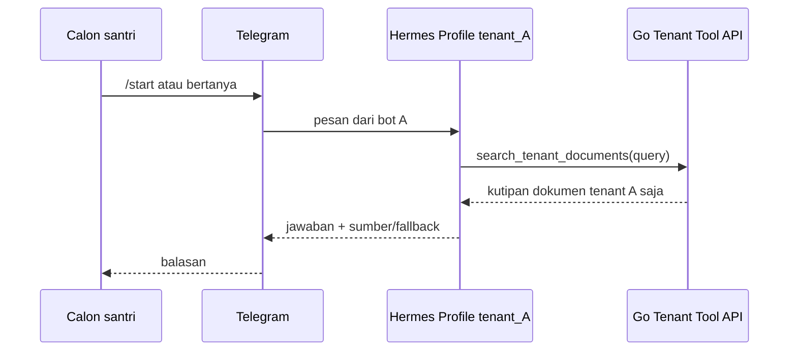

# 08 — Telegram langsung ke Hermes Profile

## Keputusan integrasi

Satu bot Telegram per tenant. Telegram tidak mengirim pesan melalui API Go untuk inference reguler. Bot token adalah milik ponpes atau akun bot yang dikelola perusahaan atas kesepakatan; **BotFather dipakai membuat bot pada MVP**, lalu admin menghubungkan token. Go mengelola identitas bot dan credential; Hermes gateway menangani chat.

## Onboarding bot

1. Admin membuat bot melalui BotFather dan memasukkan token dengan POST HTTPS.
2. Go memanggil Telegram `getMe` server-to-server untuk bot ID, username; cek uniqueness dan status.
3. Token disimpan terenkripsi/mounted secret; tidak kembali dalam response, audit perubahan tanpa payload secret.
4. Provisioner menghubungkan `TELEGRAM_BOT_TOKEN` ke profile yang tepat; verifikasi hanya satu gateway/profile menggunakan token tersebut.
5. Bot dimulai setelah semua security gates lolos; Go hanya menampilkan username, link bot dan status.

## Aspek keamanan bot publik yang belum boleh diasumsikan selesai

Hermes Telegram pada dokumentasi umum menggunakan ID allowlist/pairing; ada opsi wildcard/allow-all yang **di sebagian dokumentasi disebut dev-only**. Untuk layanan publik, harus benar-benar dibuktikan pengguna umum dapat chatting normal **tanpa** menjalankan admin slash commands, mengganti model, membaca secret, membuka terminal, menjalankan arbitrary tools, atau mengakses session pengguna lain.

**Release blocker P0:** Buat integration test dengan dua identitas Telegram (publik dan admin), verifikasi akses command dan tool memakai versi Hermes yang dipin. Jika mode publik langsung tidak menyediakan kontrol cukup kuat, jangan aktifkan bot publik: pilih runtime terisolasi + command restrictions yang dibuktikan atau bangun ingress Telegram terbatas terpisah (keputusan revisi arsitektur).

## Bot behavior

- DMs sebagai kanal utama; group chat nonaktif di P0.
- `/start` menjelaskan bahwa asisten AI, sumber informasi resmi, risiko ketidakakuratan, kontak admin, tautan privacy notice.
- Bot harus menjawab hal di luar sumber dengan abstention, bukan hallucination.
- Rate limit pengguna/tenant; debouncing spam; pesan sangat panjang dibatasi.
- Lampiran dari pengguna tidak otomatis dianggap fakta; diproses sebagai untrusted content.
- Audio/OCR gambar masuk P1 setelah keamanan dan biaya tervalidasi.
- Direct message dari bot tidak boleh dikirim kepada pengguna yang belum memulai percakapan.

## Token lifecycle

Status `PENDING`, `VALID`, `INVALID`, `ROTATING`, `REVOKED`. Bot ID unique global. Pada rotate pastikan tidak ada dua handler aktif mem-poll token yang sama. Perubahan dicatat tanpa memuat token atau prefix lengkap yang sensitif.

## Test Telegram P0

- Chat bot A memakai profile A (persona dan dokumen A), bot B profile B.
- Tembak `/model`, `/terminal`, `/exec`, command tool dan prompt injection: semua yang tidak di-allow ditolak.
- Unknown user dapat FAQ publik hanya jika security mode terbukti.
- Token B dipasang ke tenant A ditolak dengan 409, tidak beralih diam-diam.
- Saat A suspend, bot A berhenti, B tetap aktif.
