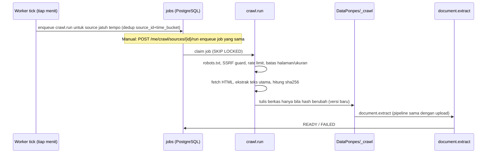

# 25 — Crawl sumber web ponpes (terjadwal + manual) dan field profil ponpes

## Ringkasan keputusan

| Pertanyaan | Jawaban |
|---|---|
| Bisakah Hermes dipakai untuk crawl? | **Bisa secara hasil, tetapi eksekusinya di Go worker, bukan tool browser di bot publik.** Hermes membaca *hasil* crawl yang sudah masuk `DataPonpes` lewat `search_tenant_documents`. |
| Mengapa bukan browser/web tool Hermes? | SEC-02 dan `15_security_privacy.md` melarang browser fetching generik untuk bot publik. Crawler harus punya kontrol SSRF, robots.txt, rate limit, kuota, dan audit yang tidak bisa dipegang prompt. |
| Peran Hermes pada crawl | Opsional (P1+): merapikan/meringkas teks hasil crawl lewat profile **internal non-publik**, tanpa tool tulis. Tidak wajib untuk MVP crawl. |
| Penjadwalan | Disimpan di PostgreSQL (`crawl_sources`), dipicu worker tick. Bukan cron per-profile Hermes, agar audit, kuota, dan manual-trigger satu jalur. Kemampuan cron Hermes perlu dibuktikan pada versi pinned bila ingin dipakai (SETUP-06). |
| Manual | Admin ponpes menekan **Crawl sekarang**; masuk job yang sama dengan jadwal. |
| Prioritas | Field Google Maps: **P0**. Crawl: **P1** (dapat dinaikkan setelah ADR-008 disetujui). |

## Field profil ponpes baru

Disimpan di tabel `tenant_profiles` (1:1 dengan `tenants`), diedit admin ponpes lewat `PATCH /me/tenant`.

| Field | Tipe | Aturan |
|---|---|---|
| `google_maps_url` | text, nullable | Wajib `https`, maks 2048 karakter, tanpa userinfo (`user:pass@`). Host allowlist: `www.google.com` (path `/maps*`), `maps.google.com`, `maps.app.goo.gl`, `goo.gl` (path `/maps*`). Selain itu `422 MAPS_URL_INVALID`. |
| `latitude`, `longitude` | numeric, nullable | Opsional; diisi hanya bila diparse dari URL panjang yang berisi `@lat,lng`. Tidak memfollow shortlink di server (hindari SSRF). |
| `website_url` | text, nullable | `http/https`, tervalidasi sama seperti sumber crawl; dipakai sebagai saran sumber crawl pertama. |

Perilaku:

- `google_maps_url` adalah **fakta resmi** ponpes; tool `admission-info` mengembalikannya agar bot menjawab "lokasi/alamat" dengan tautan, tanpa mengarang.
- Halaman Google Maps **tidak pernah di-crawl** (ketentuan layanan Google; bukan sumber teks). Hanya disimpan dan ditampilkan.
- Perubahan field tercatat di audit `tenant.settings_update`.

## Model sumber crawl

Satu tenant punya beberapa **sumber crawl** (default maks 5). Tiap sumber menghasilkan *run*; tiap run menghasilkan halaman terkumpul yang disimpan sebagai berkas teks di `DataPonpes/<tenant_id>/_crawl/<source_id>/`.

| Atribut sumber | Aturan awal |
|---|---|
| `url` (seed) | `http/https` port 80/443 saja; domain publik |
| `kind` | `SINGLE_PAGE`, `SITE` (ikuti tautan satu domain), `SITEMAP` |
| `max_depth` | default 2, maks 3 |
| `max_pages` | default 50 per run, maks 200 |
| `schedule_mode` | `MANUAL`, `INTERVAL`, `CRON` |
| `interval_minutes` | minimum 360 (6 jam), default 1440 |
| `cron_expr` + `timezone` | 5 field, default `Asia/Jakarta`; interval efektif tidak boleh < 6 jam |
| `enabled` | admin dapat jeda tanpa menghapus; superadmin dapat memaksa nonaktif |

## Sumber Google (Docs, Sheets, Slides, file Drive)

Selain situs web, admin dapat menempelkan tautan dokumen Google. Crawler **tidak memakai URL yang ditempel untuk fetch**; ia hanya mengekstrak ID dokumen (regex `[\w-]{20,}`) lalu membangun URL ekspor sendiri ke host tetap:

| `kind` | Tautan yang dikenali | URL yang di-fetch | Format hasil |
|---|---|---|---|
| `GOOGLE_DOC` | `docs.google.com/document/d/<id>/…` | `docs.google.com/document/d/<id>/export?format=txt` | teks |
| `GOOGLE_SHEET` | `docs.google.com/spreadsheets/d/<id>/…` | `…/spreadsheets/d/<id>/export?format=csv` (per-sheet `gid` bila ada) | CSV → teks ringkas |
| `GOOGLE_SLIDES` | `docs.google.com/presentation/d/<id>/…` | `…/presentation/d/<id>/export?format=txt` | teks |
| `GOOGLE_DRIVE_FILE` | `drive.google.com/file/d/<id>/…` | `drive.google.com/uc?export=download&id=<id>` | PDF/TXT lewat validasi upload yang sama |

Aturan:

- **Hanya dokumen publik** ("Siapa saja yang memiliki link", viewer). Tanpa login, tanpa OAuth, tanpa cookie — konsisten dengan batas crawler. Bila Google mengembalikan halaman login/403/404 → run `FAILED` dengan kode `NEEDS_PUBLIC_SHARING` dan pesan UI yang menjelaskan cara membuka akses. Dukungan dokumen privat via OAuth/service account adalah keputusan terpisah (Q-24).
- Folder Drive tidak didukung (tautan `/drive/folders/…` ditolak); pengguna menempelkan file satu per satu.
- `robots.txt` tidak berlaku untuk jalur ekspor dokumen milik pengguna sendiri; batas ukuran (2 MB teks, 20 MB file Drive), timeout, kuota, dan SSRF guard tetap berlaku (host dikunci ke allowlist Google; redirect hanya ke `*.googleusercontent.com`/`*.google.com`).
- Satu sumber Google = satu dokumen = satu `crawled_pages` (`kind` baru ditambahkan ke CHECK `crawl_sources.kind`). Perubahan terdeteksi lewat `content_sha256`.
- Interval minimum, run-aktif-tunggal, trigger manual, dan sitasi (judul dokumen + URL + tanggal) sama seperti sumber web.
- Sumber Google yang berisi data pribadi (nomor KTP, daftar santri) tidak boleh ditempel; UI menampilkan peringatan dan konten diperlakukan sebagai publik oleh asisten.

## Alur eksekusi

Aturan:

1. Satu run aktif per sumber (unique partial index); trigger manual saat ada run aktif → `409 CRAWL_ALREADY_RUNNING`. Trigger manual dibatasi 1 kali per 10 menit per sumber (`429`).
2. Halaman tidak berubah (hash sama) tidak membuat versi baru, hanya memperbarui `last_seen_at`.
3. Halaman yang hilang (404/410) pada 2 run berturut-turut ditandai `GONE`; berkas ditandai `DELETED` sehingga tidak muncul di retrieval.
4. Hasil crawl memakai kuota storage tenant yang sama; kuota habis → run berhenti `PARTIAL` dengan pesan jelas.
5. Run gagal mengikuti kebijakan retry `16_worker_events.md`; kegagalan permanen (robots melarang, DNS tidak ada) tidak diulang tanpa batas.
6. `next_run_at` dihitung ulang setelah run selesai (bukan sebelum), sehingga run lambat tidak menumpuk.

## Keamanan crawler (rilis blocker untuk fitur ini)

- **SSRF guard:** resolve DNS sendiri, tolak loopback, private (RFC1918), link-local (termasuk `169.254.169.254`), CGNAT, IPv6 ULA/loopback, dan alamat internal Docker; sambungkan ke IP yang sudah divalidasi (cegah DNS rebinding); validasi ulang setiap redirect (maks 5) dan tolak skema selain http/https.
- Crawler berjalan di network egress terpisah tanpa akses ke DB/Hermes management/secret.
- Hormati `robots.txt`; `User-Agent` jelas dengan kontak operator; delay minimal 1 detik per host; maks 2 koneksi paralel per run.
- Batas: 2 MB per halaman, timeout 15 detik, total 60 detik per halaman; hanya `text/html` dan `text/plain` di fase awal (PDF menyusul, lewat validasi upload yang sama).
- Teks hasil crawl diperlakukan **untrusted reference text** (sama seperti dokumen): instruksi tersembunyi di halaman web tidak mengubah tool/role (`AT-011` diperluas untuk crawl).
- Script/iframe/komentar HTML dibuang; hanya teks utama dan judul disimpan. Tidak ada eksekusi JavaScript di MVP (halaman SPA murni dapat gagal → status `NEEDS_RENDER`, backlog).
- Tidak mengirim cookie/credential; sumber yang butuh login tidak didukung.
- Setiap sumber/run/trigger manual tercatat di audit: `crawl.source_create|update|delete`, `crawl.run_manual`.

## Aturan jawaban untuk konten hasil crawl

- Tiap potongan membawa `source_ref` berupa URL asli dan tanggal crawl; bot menyebut sumber ("situs resmi, per <tanggal>").
- Bila berkas unggahan admin bertentangan dengan hasil crawl untuk fakta yang sama (mis. biaya), **berkas unggahan menang**; bila tidak bisa ditentukan, bot meminta klarifikasi atau abstain (sesuai `10_knowledge_retrieval.md`).
- Admin dapat mengeluarkan satu halaman dari index (tandai *exclude*) tanpa menghapus sumber.

## Melihat pembaruan dan mengedit hasil crawl

Admin tidak hanya melihat daftar sumber: ia dapat melihat **apa yang berubah** setiap kali sumber diambil dan **mengoreksi** teks yang dibaca asisten.

- **Umpan pembaruan** (`crawl_page_events`): tiap run mencatat `NEW` (halaman baru), `CHANGED` (isi berubah), `SOURCE_CHANGED` (sumber berubah padahal halaman sudah diedit admin) dan `GONE` (halaman hilang dari sumber, dikeluarkan dari asisten), lengkap dengan jumlah baris bertambah/berkurang. Tombol "Lihat perubahan" menampilkan baris yang ditambahkan dan dihapus.
- **Edit halaman:** teks halaman (`body_text`) dapat dikoreksi dari dashboard; berkas yang dibaca asisten dibangun ulang dari teks itu dan ditandai "Dikoreksi oleh pengelola pesantren". Hanya halaman teks/CSV hingga 512 KB yang dapat diedit; PDF dan gambar hanya berupa berkas.
- **Aturan anti-timpa:** halaman yang sudah diedit **tidak pernah ditimpa** crawl. Teks terbaru dari sumber hanya disimpan (`source_text`); bila berbeda dari dasar editan, muncul notifikasi "Sumber berubah" dengan dua pilihan: *Pakai versi terbaru dari sumber* atau *Tetap pakai versi saya*. "Kembalikan ke versi sumber" tersedia kapan saja pada halaman yang diedit.
- **Kecualikan / masukkan kembali** per halaman (`EXCLUDED`): berkas dihapus dari asisten, crawl berikutnya melewatinya.
- Semua aksi tercatat di audit (`CRAWL_PAGE_EDITED|KEPT|REVERTED|EXCLUDED|INCLUDED`).

Endpoint (di bawah `/tenants/{id}/crawl`): `GET /sources/{sid}/events|runs|pages`, `GET /events/{eid}`, `GET /pages/{pid}`, `PUT /pages/{pid}/content`, `POST /pages/{pid}/resolve` (`use_source|keep_mine`), `PATCH /pages/{pid}` (`excluded`).

## Tautan resmi: dibagikan, dipelajari, atau keduanya

Admin mengelola daftar **tautan resmi** di halaman profil (`tenant_links`, maks 20). Tiap tautan punya *jenis* (Pendaftaran online, Brosur, Jadwal, Biaya, WhatsApp, Instagram, YouTube, Facebook, TikTok, Website, Lainnya), nama tampilan, alamat, dan petunjuk "kapan dibagikan".

- **Dibagikan:** tautan masuk ke persona asisten sebagai daftar resmi, dengan aturan bahwa asisten hanya boleh membagikan tautan dari daftar itu dan tidak boleh membuat atau menebak tautan. Teks nama dan petunjuk dibersihkan (satu baris, tanpa karakter kontrol, panjang dibatasi) agar tidak dapat menyisipkan instruksi.
- **Dipelajari:** bila dicentang, tautan didaftarkan sebagai Sumber Web (harian) dan hasilnya dapat dilihat/diedit seperti sumber lain. Status "dipelajari" diturunkan dari keberadaan sumber crawl yang terhubung, bukan kolom terpisah, sehingga selalu sinkron dengan menu Sumber Web. Menghapus tautan, mematikan "pelajari", atau mengganti alamat menghapus sumber beserta hasilnya (UI meminta konfirmasi).
- **Validasi per jenis:** semua tautan wajib `https`, tanpa user/password, bukan IP/localhost. Jenis media sosial dan WhatsApp hanya menerima domain resminya. Formulir (`forms.gle`, Google Forms), WhatsApp, dan media sosial tidak dapat dipelajari karena isinya tidak terbaca sebagai teks.
- Endpoint: `GET/POST /tenants/{id}/links`, `PATCH/DELETE /tenants/{id}/links/{lid}`.

## UI admin ponpes (menu **Sumber Web**)

- Daftar sumber: URL, jenis, jadwal, status terakhir, halaman terkumpul, `next_run_at`, tombol **Crawl sekarang**, jeda/aktifkan, hapus (konfirmasi).
- Form: URL, jenis, kedalaman/batas halaman (default aman), pilihan jadwal Manual / Setiap N jam / Harian jam tertentu (UI menghasilkan interval atau cron; cron mentah hanya di mode lanjutan).
- Detail run: waktu, durasi, halaman baru/berubah/tidak berubah/gagal, kesalahan aman ter-redaksi.
- Daftar halaman terkumpul dengan status index dan aksi *exclude*.
- State loading/empty/error/retry seperti `04_ux_dashboard.md`; jadwal ditampilkan `Asia/Jakarta`, disimpan UTC.

## Batasan yang disengaja

Tidak ada crawl media sosial (Instagram/Facebook/TikTok) di fase ini — butuh login atau API resmi dan berisiko pelanggaran ketentuan platform. Tidak ada crawl lintas-domain. Tidak ada Google Maps/reviews scraping.
