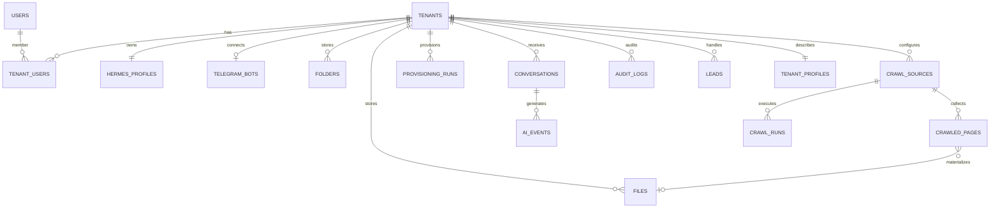

# 13 — Data model PostgreSQL dan contoh DDL

## Prinsip data

- Seluruh tabel domain tenant memakai `tenant_id UUID NOT NULL` kecuali global registry atau tabel sistem.
- Kunci asing terkait tenant harus memverifikasi parent **tenant yang sama**, bukan hanya FK ke `id`; gunakan composite unique `(tenant_id,id)` dan composite FK bila cocok.
- Server menetapkan tenant context dari auth; DB dapat menambah Row Level Security (RLS) sebagai defense-in-depth; koneksi yang dipakai superadmin dibatasi secara terpisah.
- Binary PDF/JPG/PNG berada di volume Hermes `DataPonpes`, bukan `bytea` PostgreSQL.
- Semua timestamps UTC `timestamptz`; ID UUID; audit append-only, credential encrypted-at-rest.

## Logical entities



## SQL starter — blueprint (bukan migration final; validasi sebelum dijalankan)

```sql
CREATE EXTENSION IF NOT EXISTS pgcrypto;

CREATE TABLE tenants (
  id uuid PRIMARY KEY DEFAULT gen_random_uuid(),
  name text NOT NULL,
  slug text NOT NULL UNIQUE,
  lifecycle_status text NOT NULL DEFAULT 'DRAFT'
    CHECK (lifecycle_status IN ('DRAFT','ONBOARDING','ACTIVE','SUSPENDED','ARCHIVED','DELETING','DELETED')),
  storage_quota_bytes bigint NOT NULL DEFAULT 524288000 CHECK (storage_quota_bytes >= 0),
  config_revision integer NOT NULL DEFAULT 1,
  created_at timestamptz NOT NULL DEFAULT now(),
  updated_at timestamptz NOT NULL DEFAULT now()
);

CREATE TABLE users (
  id uuid PRIMARY KEY DEFAULT gen_random_uuid(),
  email text NOT NULL UNIQUE,
  password_hash text,
  is_platform_superadmin boolean NOT NULL DEFAULT false,
  mfa_enabled boolean NOT NULL DEFAULT false,
  created_at timestamptz NOT NULL DEFAULT now()
);

CREATE TABLE tenant_users (
  tenant_id uuid NOT NULL REFERENCES tenants(id),
  user_id uuid NOT NULL REFERENCES users(id),
  role text NOT NULL CHECK (role IN ('OWNER','ADMIN','STAFF','VIEWER')),
  created_at timestamptz NOT NULL DEFAULT now(),
  PRIMARY KEY (tenant_id, user_id)
);

CREATE TABLE hermes_profiles (
  id uuid PRIMARY KEY DEFAULT gen_random_uuid(),
  tenant_id uuid NOT NULL UNIQUE REFERENCES tenants(id),
  profile_key text NOT NULL UNIQUE,
  hermes_host_id text NOT NULL,
  desired_config_hash text,
  observed_config_hash text,
  hermes_version text,
  runtime_status text NOT NULL DEFAULT 'UNKNOWN',
  verified_at timestamptz,
  created_at timestamptz NOT NULL DEFAULT now()
);

CREATE TABLE telegram_bots (
  id uuid PRIMARY KEY DEFAULT gen_random_uuid(),
  tenant_id uuid NOT NULL UNIQUE REFERENCES tenants(id),
  telegram_bot_id bigint NOT NULL UNIQUE,
  username text NOT NULL,
  credential_ref text NOT NULL,  -- encrypted secret ID; NEVER token plaintext
  status text NOT NULL DEFAULT 'PENDING',
  verified_at timestamptz,
  created_at timestamptz NOT NULL DEFAULT now()
);

CREATE TABLE folders (
  id uuid PRIMARY KEY DEFAULT gen_random_uuid(),
  tenant_id uuid NOT NULL REFERENCES tenants(id),
  parent_id uuid,
  name text NOT NULL,
  created_at timestamptz NOT NULL DEFAULT now(),
  UNIQUE (tenant_id,id),
  FOREIGN KEY (tenant_id,parent_id) REFERENCES folders(tenant_id,id)
);
-- Tambahkan unique partial index/constraint agar nama tidak duplikat dalam parent,
-- termasuk parent NULL (root): periksa kesesuaian untuk versi PostgreSQL terpilih.

CREATE TABLE files (
  id uuid PRIMARY KEY DEFAULT gen_random_uuid(),
  tenant_id uuid NOT NULL REFERENCES tenants(id),
  folder_id uuid,
  filename text NOT NULL,
  storage_key text NOT NULL UNIQUE,
  content_type text NOT NULL,
  size_bytes bigint NOT NULL CHECK (size_bytes >= 0),
  sha256 char(64) NOT NULL,
  version integer NOT NULL DEFAULT 1,
  processing_status text NOT NULL DEFAULT 'UPLOADING',
  uploaded_by uuid REFERENCES users(id),
  deleted_at timestamptz,
  created_at timestamptz NOT NULL DEFAULT now(),
  updated_at timestamptz NOT NULL DEFAULT now(),
  UNIQUE (tenant_id,id),
  FOREIGN KEY (tenant_id,folder_id) REFERENCES folders(tenant_id,id)
);
CREATE INDEX idx_files_tenant_folder ON files(tenant_id,folder_id,created_at DESC)
  WHERE deleted_at IS NULL;

CREATE TABLE provisioning_runs (
  id uuid PRIMARY KEY DEFAULT gen_random_uuid(),
  tenant_id uuid NOT NULL REFERENCES tenants(id),
  kind text NOT NULL,
  status text NOT NULL,
  current_step text,
  attempt integer NOT NULL DEFAULT 0,
  locked_until timestamptz,
  error_code text,
  error_public_message text,
  created_at timestamptz NOT NULL DEFAULT now(),
  updated_at timestamptz NOT NULL DEFAULT now()
);
CREATE UNIQUE INDEX ux_active_provision_run ON provisioning_runs(tenant_id)
  WHERE status IN ('QUEUED','RUNNING','WAITING_INPUT','VERIFYING');

CREATE TABLE audit_logs (
  id uuid PRIMARY KEY DEFAULT gen_random_uuid(),
  tenant_id uuid REFERENCES tenants(id),
  actor_user_id uuid REFERENCES users(id),
  actor_type text NOT NULL,
  action text NOT NULL,
  target_type text,
  target_id text,
  request_id text,
  details_redacted jsonb NOT NULL DEFAULT '{}'::jsonb,
  occurred_at timestamptz NOT NULL DEFAULT now()
);
CREATE INDEX idx_audit_tenant_time ON audit_logs(tenant_id,occurred_at DESC);

CREATE TABLE ai_events (
  id uuid PRIMARY KEY DEFAULT gen_random_uuid(),
  tenant_id uuid NOT NULL REFERENCES tenants(id),
  external_event_id text NOT NULL,
  event_type text NOT NULL,
  profile_key text NOT NULL,
  external_session_id text,
  external_turn_id text,
  model text,
  usage jsonb,
  metadata_redacted jsonb NOT NULL DEFAULT '{}'::jsonb,
  occurred_at timestamptz NOT NULL,
  received_at timestamptz NOT NULL DEFAULT now(),
  UNIQUE (tenant_id, external_event_id)
);
CREATE INDEX idx_ai_events_tenant_time ON ai_events(tenant_id, occurred_at DESC);
```

## Profil ponpes dan crawl (P0 untuk `tenant_profiles`, P1 untuk crawl) — blueprint

Detail perilaku: `01_Arsitektur/25_crawl_sumber_web.md`.

```sql
CREATE TABLE tenant_profiles (
  tenant_id uuid PRIMARY KEY REFERENCES tenants(id),
  google_maps_url text
    CHECK (google_maps_url IS NULL OR (length(google_maps_url) <= 2048 AND google_maps_url ~ '^https://')),
  latitude numeric(9,6) CHECK (latitude BETWEEN -90 AND 90),
  longitude numeric(9,6) CHECK (longitude BETWEEN -180 AND 180),
  website_url text CHECK (website_url IS NULL OR length(website_url) <= 2048),
  updated_at timestamptz NOT NULL DEFAULT now()
);
-- Validasi host allowlist Google Maps dilakukan di service Go (bukan hanya CHECK).

CREATE TABLE crawl_sources (
  id uuid PRIMARY KEY DEFAULT gen_random_uuid(),
  tenant_id uuid NOT NULL REFERENCES tenants(id),
  url text NOT NULL CHECK (length(url) <= 2048),
  kind text NOT NULL DEFAULT 'SITE' CHECK (kind IN ('SINGLE_PAGE','SITE','SITEMAP',
    'GOOGLE_DOC','GOOGLE_SHEET','GOOGLE_SLIDES','GOOGLE_DRIVE_FILE')),
  max_depth smallint NOT NULL DEFAULT 2 CHECK (max_depth BETWEEN 0 AND 3),
  max_pages integer NOT NULL DEFAULT 50 CHECK (max_pages BETWEEN 1 AND 200),
  schedule_mode text NOT NULL DEFAULT 'MANUAL' CHECK (schedule_mode IN ('MANUAL','INTERVAL','CRON')),
  interval_minutes integer CHECK (interval_minutes IS NULL OR interval_minutes >= 360),
  cron_expr text,
  timezone text NOT NULL DEFAULT 'Asia/Jakarta',
  enabled boolean NOT NULL DEFAULT true,
  forced_disabled boolean NOT NULL DEFAULT false,  -- hanya superadmin
  next_run_at timestamptz,
  last_run_at timestamptz,
  last_status text,
  created_by uuid REFERENCES users(id),
  created_at timestamptz NOT NULL DEFAULT now(),
  updated_at timestamptz NOT NULL DEFAULT now(),
  UNIQUE (tenant_id, id),
  UNIQUE (tenant_id, url),
  CHECK (schedule_mode <> 'INTERVAL' OR interval_minutes IS NOT NULL),
  CHECK (schedule_mode <> 'CRON' OR cron_expr IS NOT NULL)
);
CREATE INDEX idx_crawl_due ON crawl_sources(next_run_at)
  WHERE enabled AND NOT forced_disabled AND schedule_mode <> 'MANUAL';

CREATE TABLE crawl_runs (
  id uuid PRIMARY KEY DEFAULT gen_random_uuid(),
  tenant_id uuid NOT NULL REFERENCES tenants(id),
  source_id uuid NOT NULL,
  trigger text NOT NULL CHECK (trigger IN ('SCHEDULED','MANUAL')),
  triggered_by uuid REFERENCES users(id),
  status text NOT NULL DEFAULT 'QUEUED'
    CHECK (status IN ('QUEUED','RUNNING','SUCCEEDED','PARTIAL','FAILED','CANCELLED')),
  pages_new integer NOT NULL DEFAULT 0,
  pages_changed integer NOT NULL DEFAULT 0,
  pages_unchanged integer NOT NULL DEFAULT 0,
  pages_failed integer NOT NULL DEFAULT 0,
  error_code text,
  error_public_message text,
  started_at timestamptz,
  finished_at timestamptz,
  created_at timestamptz NOT NULL DEFAULT now(),
  FOREIGN KEY (tenant_id, source_id) REFERENCES crawl_sources(tenant_id, id)
);
CREATE UNIQUE INDEX ux_active_crawl_run ON crawl_runs(source_id)
  WHERE status IN ('QUEUED','RUNNING');

CREATE TABLE crawled_pages (
  id uuid PRIMARY KEY DEFAULT gen_random_uuid(),
  tenant_id uuid NOT NULL REFERENCES tenants(id),
  source_id uuid NOT NULL,
  url text NOT NULL,
  title text,
  content_sha256 char(64),
  file_id uuid,                       -- berkas teks di DataPonpes/_crawl
  status text NOT NULL DEFAULT 'ACTIVE' CHECK (status IN ('ACTIVE','GONE','EXCLUDED','FAILED')),
  miss_count smallint NOT NULL DEFAULT 0,
  first_seen_at timestamptz NOT NULL DEFAULT now(),
  last_seen_at timestamptz NOT NULL DEFAULT now(),
  last_changed_at timestamptz,
  UNIQUE (source_id, url),
  FOREIGN KEY (tenant_id, source_id) REFERENCES crawl_sources(tenant_id, id),
  FOREIGN KEY (tenant_id, file_id) REFERENCES files(tenant_id, id)
);
```

Catatan: `files.source_type` (`UPLOAD` default, `CRAWL`) ditambahkan agar retrieval dapat menandai asal konten; file `CRAWL` tidak dapat diubah manual oleh admin (hanya di-*exclude*).

## Tabel lanjutan dan wajib saat P1

- `file_versions`, `document_extractions`, `document_chunks`, `document_processing_jobs`, `storage_operations`, `session_summaries`, `ai_usage`, `model_pricing`, `ai_cost_rollups`, `bot_health_checks`, `outbox_events`, `idempotency_keys`, `leads`, `handoff_requests`, `admission_applications`, `consent_records`.
- Pada P0 metadata retrieval boleh gunakan `document_extractions(file_id, version, text_content, page_map, status)` bila ukuran corpus kecil. Table ini cache dan bisa dibangun ulang dari file asli.

## sqlc sample

```sql
-- name: ListTenantFiles :many
SELECT id, filename, content_type, size_bytes, processing_status
FROM files
WHERE tenant_id = $1 AND folder_id IS NOT DISTINCT FROM sqlc.narg(folder_id)::uuid
  AND deleted_at IS NULL
ORDER BY created_at DESC
LIMIT $2 OFFSET $3;
```

Jika `sqlc.narg` pada query versi yang dipin menghasilkan tipe tidak sesuai, gunakan dua query `ListTenantRootFiles` dan `ListTenantFolderFiles`. Semua query repository untuk admin harus menerima tenant context eksplisit; test cross-tenant merupakan bagian CI.

## Migration policy

Migrasi `goose` up/down yang destruktif memerlukan maintenance plan; schema drift checked via CI; setiap transaksi onboarding menyimpan tenant dan provisioning job bersama-sama; hak DB aplikasi tidak boleh superuser.
