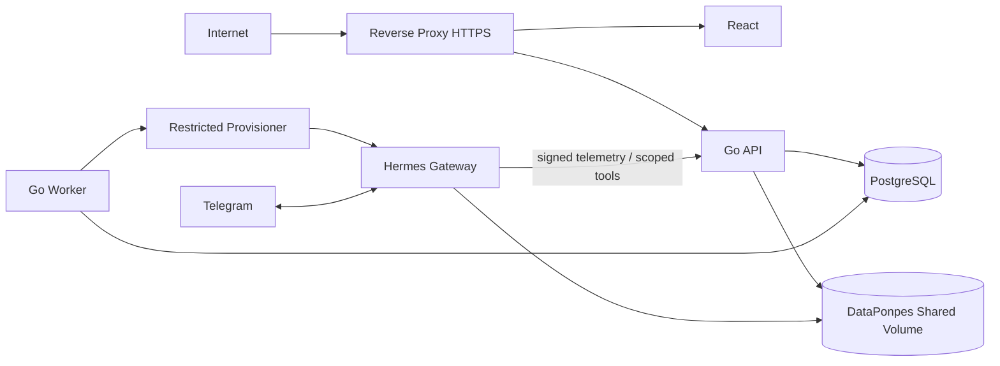

# 18 — Deployment, operasi, backup dan recovery

## MVP topology (single host, dua tenant)

- Reverse proxy/TLS → React web + Go API.
- Go worker terpisah; PostgreSQL pada private network/volume.
- Hermes multiplexer pada private network, satu default gateway melayani named profiles; bot Telegram outbound polling/connection sebagaimana supported release.
- Persistent volume Hermes menyimpan profile homes dan folder tambahan `DataPonpes` (mount path aktual diverifikasi saat setup).
- Go storage process diberi mount RW **hanya subfolder DataPonpes**; Hermes provisioner mempunyai jalur ke profile homes yang lebih privileged, tanpa membuka shell ke public UI.
- Backup agent mengambil backup PostgreSQL + snapshot volume profile/DataPonpes secara konsisten.



## Environment vars (nama usulan Go, bukan Hermes native)

```dotenv
APP_ENV=production
HTTP_LISTEN_ADDR=:8080
DATABASE_URL=postgres://...         # inject via secret, not repo
HERMES_DATA_ROOT=/srv/hermes/DataPonpes
HERMES_PROFILE_ROOT=/srv/hermes/profiles
HERMES_EXECUTABLE=/usr/local/bin/hermes
TELEGRAM_VALIDATE_API_BASE=https://api.telegram.org
AUDIT_RETENTION_DAYS=365
TRANSCRIPT_RETENTION_DAYS=30
UPLOAD_MAX_BYTES=20971520
```

Actual Hermes secrets in **per-profile** `.env` or secret injection, never Go frontend. Network: DB and Hermes management endpoints private only. Hook/Go internal routes require identity and TLS/mTLS.

## Capacity planning

Pilot 2 ponpes: measure idle/active memory, CPU per Hermes profile, model latency, DB storage, disk file usage. Scaling from tens to hundreds requires **load benchmark** (multiplexer event loop, per-profile adapters, Telegram limits, memory growth, credential operation, storage throughput). Jangan menjanjikan jumlah tenant tertentu sebelum profiling.

## Monitoring infra

Host disk >80%, inode >80%, API errors, DB locks, worker queue lag, Telegram bot health, Hermes gateway restart, rate-limit responses, backup failure, index backlog. Pinned image healthcheck dan restart policy, avoid loops on bad config.

## Backup / DR

- PostgreSQL daily full + WAL/PITR bila sesuai RPO; encrypted backup.
- Snapshot volume DataPonpes dan profile homes dengan coordination point/manifest agar file metadata dan isi file satu versi.
- Secret encryption keys backed up out-of-band; enforce restore key access.
- **Pilot proposal:** RPO 24 jam dan RTO 8 jam hingga diuji; target komersial final TBD.
- Monthly restore drill untuk satu tenant ke environment isolasi, test checksum file dan credential rotation; jangan restore live bot token ke staging aktif.

## Upgrade Hermes runbook

1. Pin new release, review changes profile/gateway/Telegram/hooks/safety/CLI.
2. Stage with 2 synthetic tenant profiles and files, verify commands and config.
3. Run acceptance security suite, especially public Telegram command gating.
4. Snapshot DB + volumes, drain/park as needed, deploy maintenance window.
5. Reconcile each profile and tool; rollback release if health/regression fails.

## Incident response

- Suspected token leak: park profile, revoke via BotFather, rotate, verify bot ID/permissions, audit interactions.
- Suspected cross-tenant leak: globally stop unsafe tools, park affected profiles, preserve event/audit evidence, notify responsible parties per policy, patch + retest before resume.
- Disk full: stop uploads, keep read-only response where safe, expand capacity then reconciliation.
- DB outage: UI degraded, tool Go fails closed; Hermes should abstain if knowledge unavailable.
