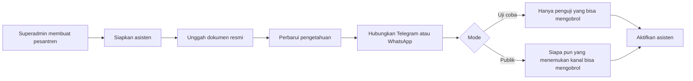

# 01 — Mengenal AHLAN

AHLAN adalah ruang kerja untuk banyak pondok pesantren. Tiap pesantren punya asisten sendiri. Asisten menjawab calon santri dan wali di Telegram dan WhatsApp dari dokumen serta sumber resmi yang pengurus unggah. Pengurus memantau percakapan, pertanyaan yang belum terjawab, dan aktivitas dari dashboard.

Calon santri tidak membuat akun web untuk bertanya. Mereka membuka bot atau halaman publik pesantren.

## Dua bagian yang perlu dibedakan

| Bagian | Siapa yang melihat | Apa yang terjadi di sana |
|---|---|---|
| Dashboard (aplikasi web) | Superadmin dan pengurus yang punya akun | Mengatur pesantren, dokumen, kanal, pengguna, dan membaca jejak aktivitas |
| Asisten (Hermes) | Calon santri lewat Telegram atau WhatsApp | Membalas percakapan. Satu pesantren punya satu asisten |

Pesan calon santri tidak diketik ulang lewat server dashboard. Telegram dan WhatsApp terhubung ke asisten pesantren itu. Dashboard mengatur identitas, berkas, dan menerima catatan percakapan. Karena itu, dashboard yang sedang gangguan tidak otomatis mematikan bot yang sudah berjalan. Sebaliknya, asisten yang belum diaktifkan tidak akan membalas meskipun dashboard bisa dibuka.

## Yang disimpan di mana

- Data pesantren, pengguna, metadata berkas, percakapan, dan jejak aktivitas ada di basis data.
- Isi berkas (PDF, gambar, teks) ada sebagai file di folder pesantren, bukan di dalam basis data.
- Token bot tidak ditampilkan kembali setelah disimpan. Layar detail bot mengosongkan rahasia itu.

## Yang aplikasi ini tidak kerjakan

- Tidak memutuskan santri diterima atau pembayaran sah.
- Tidak menagih langganan dari dalam dashboard.
- Tidak meminta calon santri mendaftar akun untuk membaca FAQ.
- Tidak membaca situs yang butuh login, Google Maps sebagai halaman yang di-crawl, atau media sosial sebagai bahan bacaan asisten. Tautan Instagram, Facebook, TikTok, YouTube, dan WhatsApp bisa disimpan untuk dibagikan, tetapi tidak dijadikan teks pengetahuan.
- Tidak memakai verifikasi MFA pada saat masuk, meskipun kolom itu ada di data pengguna.

## Alur singkat sampai asisten melayani

Langkah di layar admin pesantren dan di detail pesantren superadmin memakai urutan yang sama pada panel asisten: siapkan asisten, hubungkan kanal, lalu aktifkan.
