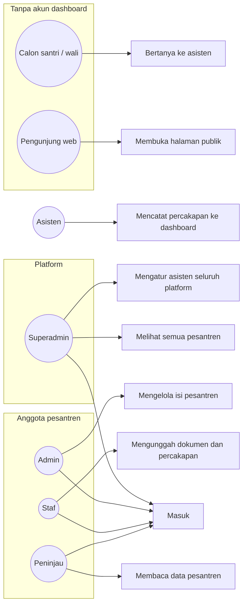
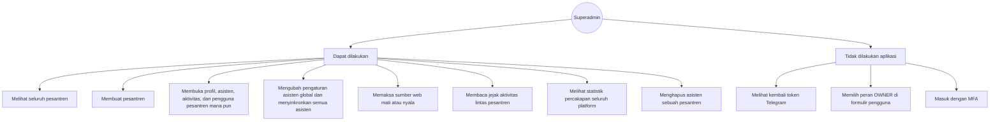
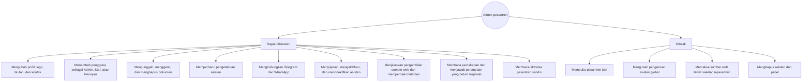
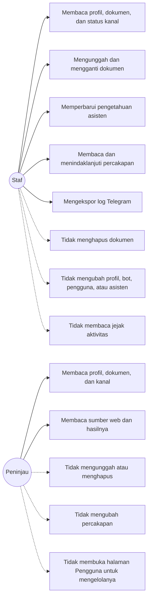

# 02 — Peran dan use case

Ada dua macam identitas.

- **Superadmin** adalah akun platform (`is_platform_superadmin`). Bukan peran di dalam satu pesantren. Setelah masuk, akun ini membuka dashboard platform dan dapat membuka data pesantren mana pun.
- **Anggota pesantren** punya peran pada satu pesantren: `ADMIN`, `STAFF`, atau `VIEWER`. Formulir tambah pengguna hanya menawarkan ketiga peran itu. Peran `OWNER` ada di data dan boleh menangguhkan pesantren, tetapi tidak bisa dipilih dari formulir.

Satu orang bisa menjadi anggota lebih dari satu pesantren. Layar pesantren memakai pesantren yang terakhir dipilih di peramban itu.

## Diagram keseluruhan

## Superadmin

## Admin pesantren

Tombol **Hapus asisten** hanya tampil untuk superadmin.

## Staf dan peninjau

## Matriks hak

| Pekerjaan | Superadmin | Admin | Staf | Peninjau | Pengunjung |
|---|---|---|---|---|---|
| Masuk ke dashboard | Ya | Ya | Ya | Ya | Tidak |
| Melihat semua pesantren | Ya | Hanya pesantrennya | Hanya pesantrennya | Hanya pesantrennya | Tidak |
| Membuat pesantren dari menu Pesantren | Ya | Tidak ada menu platform | Tidak | Tidak | Tidak |
| Mengubah profil, logo, tautan, kontak | Ya | Ya | Tidak | Tidak | Tidak |
| Menambah pengguna | Ya | Ya | Tidak | Tidak | Tidak |
| Mengunggah dan mengganti dokumen | Ya | Ya | Ya | Tidak | Tidak |
| Menghapus dokumen | Ya | Ya | Tidak | Tidak | Tidak |
| Memperbarui pengetahuan | Ya | Ya | Ya | Tidak | Tidak |
| Menghubungkan Telegram atau WhatsApp | Ya | Ya | Tidak | Tidak | Tidak |
| Menyiapkan atau mengaktifkan asisten | Ya | Ya | Tidak | Tidak | Tidak |
| Menghapus asisten | Ya | Tidak | Tidak | Tidak | Tidak |
| Mengubah layanan WhatsApp dan admin routing | Ya | Ya | Tidak | Tidak | Tidak |
| Menjalankan dan menyunting sumber web | Ya | Ya | Tidak | Tidak | Tidak |
| Memaksa sumber web mati | Ya | Tidak | Tidak | Tidak | Tidak |
| Pengaturan asisten untuk semua pesantren | Ya | Tidak | Tidak | Tidak | Tidak |
| Membaca aktivitas | Semua pesantren | Pesantren sendiri | Tidak | Tidak | Tidak |
| Menindaklanjuti percakapan | Ya | Ya | Ya | Tidak | Tidak |
| Melihat token bot | Tidak | Tidak | Tidak | Tidak | Tidak |
| Membuka `/p/{slug}` | Ya | Ya | Ya | Ya | Ya |
| Mengobrol dengan bot | Hanya jika kanal publik atau identitasnya ada di daftar uji | Sama | Sama | Sama | Sama |

## Use case

### Masuk ke ruang kerja

Pengurus membuka `/login`, mengisi email dan kata sandi, lalu masuk. Superadmin tiba di **Dashboard superadmin**. Anggota pesantren tiba di dashboard pesantren. Jika email atau kata sandi salah, layar menampilkan satu kalimat yang sama. Aplikasi tidak memberitahu bagian mana yang salah.

Sesi bertahan 24 jam di cookie peramban. Keluar lewat menu akun, **Keluar**.

### Melihat dan membuat pesantren

Superadmin membuka **Pesantren**, mencari nama atau slug, dan menyaring status Aktif atau Ditangguhkan. **Tambah Pesantren** meminta nama dan slug. Slug terisi dari nama dan hanya boleh huruf kecil, angka, serta tanda hubung. Pesantren baru berstatus draf. Menyiapkan asisten dilakukan setelahnya, dari detail pesantren.

Slug yang sudah dipakai tidak bisa dipakai lagi.

### Menyiapkan asisten satu pesantren

Dari **Asisten AI** (ruang pesantren) atau tab **Asisten & pengetahuan** (detail pesantren superadmin):

1. **Siapkan asisten** bila statusnya belum disiapkan.
2. **Hubungkan Telegram** dan/atau **Hubungkan WhatsApp**.
3. **Aktifkan** setelah salah satu kanal terhubung.

Admin dapat **Nonaktifkan**, **Mulai ulang asisten**, dan **Perbarui asisten**. **Hapus asisten** hanya untuk superadmin.

### Menghubungkan Telegram

Tombol **Hubungkan Telegram** membuka formulir bot. Mode **Uji coba** mewajibkan minimal satu ID Telegram penguji. Beberapa ID dipisah koma. Mode **Publik** mengizinkan siapa pun yang menemukan bot. Simpan dengan **Simpan & aktifkan**. Token yang sudah tersimpan tidak muncul lagi di layar. **Lepas** melepas bot dari pesantren itu.

### Menghubungkan WhatsApp

**Hubungkan WhatsApp** menampilkan kode QR. Pindai dari ponsel yang nomornya akan menjadi nomor asisten. Kode berlaku sekitar 3 menit. Jika kedaluwarsa, pilih **Buat ulang**. **Simpan & aktifkan** hanya bisa ditekan setelah status terhubung.

Pada formulir yang sama pilih layanan nomor:

- **Khusus PSB** — asisten langsung menjawab urusan penerimaan.
- **Umum** — asisten menanyakan keperluan dulu. Urusan PSB dijawab asisten. Urusan lain diarahkan ke admin yang cocok, dan admin itu diberitahu di WhatsApp.

Mode akses sama seperti Telegram: **Uji coba** (daftar nomor) atau **Publik**.

Daftar admin yang menerima arahan diatur di **Admin WhatsApp**, terpisah dari kontak yang tampil ke pengunjung.

### Mengelola dokumen

Di **Dokumen**, admin atau staf membuat folder, mengunggah berkas, lalu menekan **Perbarui pengetahuan asisten**. Satu berkas paling besar 20 MB. Nama berkas tidak boleh berisi path. Peninjau dapat melihat dan mengunduh, bukan mengunggah. Staf tidak dapat menghapus.

Logo pesantren diunggah dari halaman asisten, paling besar 2 MB, berupa PNG, JPEG, atau WEBP. SVG ditolak.

### Mengelola pengguna pesantren

Admin membuka **Pengguna**, lalu **Tambah pengguna**. Isi email, kata sandi sementara minimal 10 karakter, dan peran Admin, Staf, atau Peninjau. Staf dan peninjau yang membuka halaman yang sama melihat pemberitahuan bahwa mereka tidak memiliki izin.

### Menindaklanjuti percakapan

**Percakapan** menampilkan log Telegram: pertanyaan pengunjung dan balasan asisten. Tampilan bisa berupa tabel penuh atau kelompok percakapan. **Ekspor Excel** mengunduh log yang sedang tampil. Admin dan staf dapat mengubah status percakapan. Peninjau tidak.

### Melengkapi jawaban yang belum ada

Jika asisten membalas dengan kalimat *Mohon maaf, informasi tersebut belum tersedia di data kami.*, pertanyaan itu masuk ke **Pertanyaan**. Admin menulis jawaban. Jawaban yang disimpan ikut menjadi bahan asisten. Paling banyak 200 pertanyaan terbuka disimpan. Yang paling lama terlepas bila melewati batas itu. Paling banyak 100 jawaban yang diserahkan ke asisten.

### Membuka halaman publik

Siapa pun dapat membuka `/p/{slug}` tanpa masuk. Halaman itu memuat profil dan tautan yang ditandai tampil publik. Ini bukan akun dashboard.

### Bertanya sebagai calon santri

Calon santri menyapa bot Telegram atau WhatsApp. Pada mode uji coba, hanya ID atau nomor yang didaftarkan yang dilayani. Pada mode publik, siapa pun yang menghubungi nomor atau bot itu dilayani. Percakapan tercatat di dashboard pesantren tersebut.

### Mencatat percakapan

Asisten mengirim peristiwa percakapan ke aplikasi dengan kunci layanan, bukan dengan akun pengurus. Pengurus hanya melihat hasilnya di Percakapan dan Pertanyaan.

## Mengatur asisten seluruh platform

Hanya superadmin. Menu **Profil Asisten** memuat daftar kesehatan profil dan tab pengaturan. **Sinkronkan** menerapkan pengaturan ke semua asisten. Jika opsi mulai ulang yang aktif dipilih, asisten yang sedang berjalan terputus sesaat. Aplikasi meminta konfirmasi sebelum proses ini, karena prosesnya berjalan di latar dan bisa memakan waktu beberapa menit.
