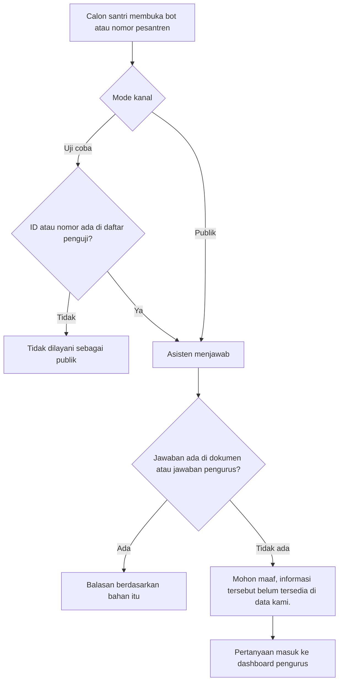

# 07 — Calon santri dan halaman publik

Bab ini untuk dua pihak yang tidak memakai dashboard: pengunjung situs, dan calon santri atau wali yang mengobrol dengan asisten. Pengurus membacanya agar tahu apa yang dilihat pihak luar.

## Halaman publik pesantren

Alamatnya `/p/{slug}`. Slug adalah identitas pendek pesantren, misalnya `darul-ilmi`.

Halaman ini tidak meminta login. Isinya profil yang pengurus simpan dan tautan yang ditandai untuk publik, termasuk logo bila ada. Ada juga halaman per jenis tautan di `/p/{slug}/{jenis}`.

Nomor admin routing WhatsApp tidak ikut tampil. Kontak yang tampil adalah kontak person yang pengurus isi untuk dibagikan.

Beranda AHLAN (`/`) menjelaskan produk untuk calon pengguna platform, bukan ruang kerja satu pesantren. Di sana tertulis bahwa jawaban merujuk dokumen resmi, pertanyaan yang tidak ada di dokumen tetap tercatat, dan kanal yang dipakai adalah WhatsApp serta Telegram.

Halaman lain yang bersifat bacaan: kebijakan privasi, panduan PSB, dan halaman pengenalan chatbot. Semuanya dapat dibuka tanpa akun.

## Mengobrol dengan asisten

Mode **Khusus PSB** pada WhatsApp: asisten langsung menjawab urusan penerimaan.

Mode **Umum**: asisten bertanya keperluan lebih dulu. Urusan penerimaan dijawab asisten. Urusan lain diarahkan ke admin pesantren yang cocok, dan admin itu mendapat pemberitahuan WhatsApp. Calon santri tidak melihat daftar nomor admin itu.

Asisten bukan petugas yang menyatakan santri diterima atau pembayaran berhasil. Untuk hal itu, calon santri diarahkan ke pengurus lewat kontak resmi.

## Apa yang tercatat

Percakapan masuk ke dashboard pesantren pemilik bot, pada kanal Telegram atau WhatsApp. Pengurus pesantren lain tidak melihatnya. Berkas yang dikirim pengunjung di cache asisten dihapus setelah 60 menit.

Jika layanan sedang ramai atau sedang tidak tersedia, asisten memakai kalimat maaf bawaan, misalnya meminta pengunjung mencoba lagi nanti. Kalimat itu ada di pengaturan persona asisten, bukan di halaman publik.
