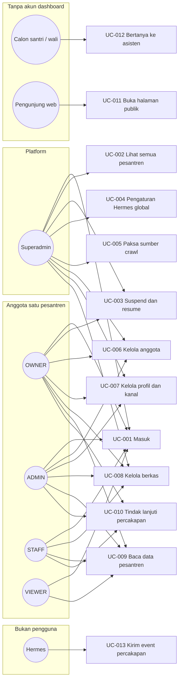
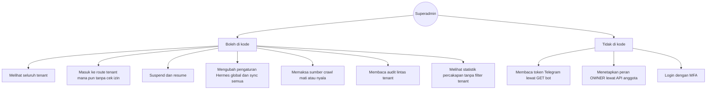
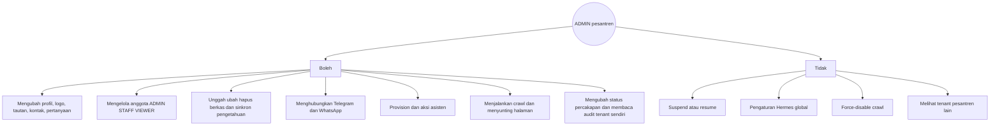
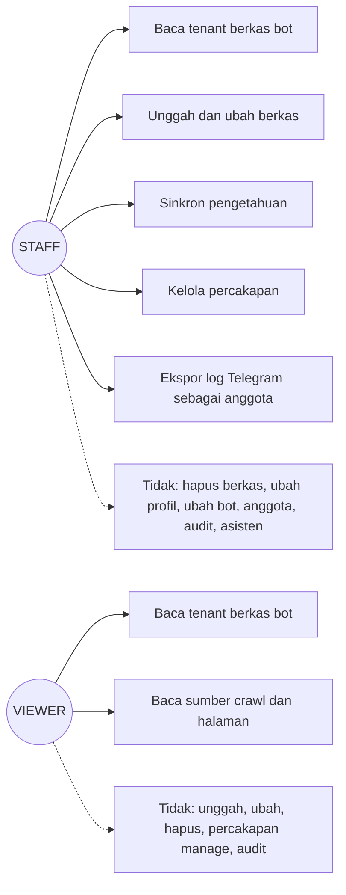

# 05 — Use case

ID use case stabil. Mereka mengikat aktor ke requirement, bukan menambah kewajiban baru.

## 5.1 Diagram ringkas per peran

## 5.2 Superadmin — yang boleh dan yang tidak

## 5.3 Admin pesantren (OWNER dan ADMIN)

OWNER dan ADMIN berbagi menu `/ponpes/*`. Perbedaan yang terbukti: hanya OWNER (dan superadmin) yang lolos `tenant:lifecycle`.

OWNER: sama dengan diagram di atas, ditambah suspend dan resume (UC-003).

## 5.4 Staf dan viewer

## 5.5 Katalog use case

### UC-001 Masuk ke ruang kerja

| | |
|---|---|
| Aktor | Superadmin, OWNER, ADMIN, STAFF, VIEWER |
| Prasyarat | Akun `users` dengan `password_hash` |
| Pemicu | Submit formulir `/login` |
| Alur utama | FR-AUTH-001 lalu FR-AUTH-006 |
| Alternatif | Sesi masih hidup: langsung diarahkan |
| Kesalahan | 401, pesan generik di UI |
| Pascakondisi | Cookie `session` httpOnly, kedaluwarsa 24 jam |
| Requirement | FR-AUTH-001, FR-AUTH-003, FR-AUTH-006 |

### UC-002 Melihat daftar pesantren

| | |
|---|---|
| Aktor utama | Superadmin melihat semua. Anggota melihat miliknya (FR-TENANT-001). |
| Prasyarat | UC-001 |
| Pascakondisi | Tidak ada perubahan data |
| Requirement | FR-TENANT-001 |

### UC-003 Menangguhkan atau mengembalikan ke onboarding

| | |
|---|---|
| Aktor | Superadmin, OWNER |
| Prasyarat | Tenant ada. Aktor punya `tenant:lifecycle` atau flag superadmin. |
| Alur utama | POST suspend atau resume. Respons 204. |
| Kesalahan | ADMIN/STAFF/VIEWER: 403 |
| Pascakondisi | `lifecycle_status` = `SUSPENDED` atau `ONBOARDING` |
| Requirement | FR-TENANT-004 |

PRD menyebut bot tenant lain tidak terpengaruh. Isolasi profile (satu profile per tenant) mendukung itu [INFERRED] untuk efek runtime Hermes; SRS tidak menyatakan uji otomatis lintas tenant sudah hijau tanpa melihat hasil `go test` di lingkungan ini.

### UC-004 Mengubah pengaturan asisten global

| | |
|---|---|
| Aktor | Superadmin |
| Prasyarat | Flag superadmin, Hermes control tersedia |
| Alur utama | PATCH `/api/v1/hermes/settings` dalam batas panjang FR-AST-005 |
| Kesalahan | Bukan superadmin: 403. Apply gagal: 502 |
| Pascakondisi | Baris pengaturan global baru; restart asisten aktif dijadwalkan |
| Requirement | FR-AST-005 |

### UC-005 Memaksa sumber crawl

| | |
|---|---|
| Aktor | Superadmin |
| Alur | PATCH `/api/v1/crawl/sources/:sid/force` |
| Kesalahan | Selain superadmin: 403 |
| Requirement | FR-KB-005 |

### UC-006 Mengelola anggota

| | |
|---|---|
| Aktor | Superadmin, OWNER, ADMIN |
| Alur | POST atau PATCH members sesuai FR-MEM-002 dan FR-MEM-003 |
| Pascakondisi | Baris `tenant_users` baru atau peran berubah. Bukan OWNER dan bukan SUPERADMIN. |
| Requirement | FR-MEM-001 … FR-MEM-004 |

### UC-007 Mengelola profil dan kanal

| | |
|---|---|
| Aktor | Superadmin, OWNER, ADMIN (`tenant:update` dan `bot:update`) |
| Alur | Simpan profil, logo, tautan, lalu Telegram dan/atau WhatsApp |
| Pascakondisi | Token tidak terbaca kembali lewat GET bot |
| Requirement | FR-TG-001, FR-TG-002, FR-WA-001, FR-WA-002, FR-KB-001, FR-FILE-006 |

### UC-008 Mengelola berkas pengetahuan

| | |
|---|---|
| Aktor | Superadmin, OWNER, ADMIN, STAFF (hapus: tanpa STAFF) |
| Alur | Unggah atau buat folder, lalu sinkron (FR-AST-003) |
| Batas | 20 MiB per berkas |
| Requirement | FR-FILE-001 … FR-FILE-005, FR-AST-003 |

### UC-009 Membaca data pesantren

| | |
|---|---|
| Aktor | Semua anggota termasuk VIEWER, plus superadmin |
| Alur | GET tenant, files, folders, bot, knowledge status, sumber crawl |
| Pascakondisi | Tidak ada tulis |
| Requirement | FR-TENANT-008, FR-FILE-001, FR-AST-004, FR-KB-004 bagian baca |

### UC-010 Menindaklanjuti percakapan dan pertanyaan

| | |
|---|---|
| Aktor | STAFF, ADMIN, OWNER, superadmin |
| Alur | Ubah status percakapan; jawab atau abaikan pertanyaan |
| Requirement | FR-CONV-003, FR-QC-001, FR-QC-003 |

### UC-011 Membuka halaman publik

| | |
|---|---|
| Aktor | Pengunjung, tanpa sesi |
| Alur | Buka `/p/{slug}` yang memanggil API publik |
| Requirement | FR-PUB-001, FR-PUB-003 |

### UC-012 Bertanya kepada asisten

| | |
|---|---|
| Aktor | Calon santri / wali pada kanal |
| Prasyarat | Kanal PUBLIC, atau identitas ada di daftar uji |
| Alur utama | Pesan sampai ke Hermes. Jika dokumen tidak memuat jawaban, balasan memuat marker FR-QC-003 dan pertanyaan tercatat. |
| Pascakondisi | Baris percakapan kanal TELEGRAM atau WHATSAPP. Dashboard tidak wajib dilalui. |
| Requirement | FR-QC-003, FR-CONV-001, FR-TG-001, FR-WA-001 |

[INFERRED] Hermes benar-benar menolak mengarang di luar marker. Kode mengenali marker; kebijakan prompt ada di template `templates/SOUL.template.md` dan `KNOWLEDGE_POLICY.template.md`. Eval set PRD FR-008 tidak ada hasilnya di SRS ini.

### UC-013 Mengirim event dari Hermes

| | |
|---|---|
| Aktor | Hermes (sistem) |
| Prasyarat | Header `X-Hermes-Event-Key` cocok |
| Alur | POST events atau handoff |
| Kesalahan | Kunci salah: ditolak, tidak membuat sesi pengguna |
| Requirement | FR-CONV-004 |

## 5.6 Yang tidak boleh dilakukan peran mana pun lewat file manager

Menurut PRD out-of-scope P0, admin tidak menulis `.env`, `config.yaml`, atau `SOUL.md` bebas dari file manager. Pengaturan soul global lewat PATCH settings superadmin, dengan batas panjang FR-AST-005, bukan lewat unggah berkas sembarang. [CONFIRMED] sebagai batas produk PRD; penolakan nama file `.env` secara khusus di `safeName` hanya menolak path, bukan denylist nama [INFERRED]. Lihat OQ-12.
