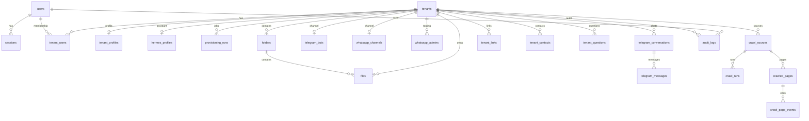

# 08 — Kebutuhan data

## 8.1 Penyimpanan

| Simpanan | Isi | Bukan isi |
|---|---|---|
| PostgreSQL | Pengguna, sesi, tenant, keanggotaan, metadata berkas, profil, kanal, percakapan, crawl, audit, pengaturan Hermes | Byte PDF/JPG (`README.md`) |
| Disk `DATA_ROOT/DataPonpes/{tenant_id}` | Berkas unggahan dan logo | Metadata relasional |
| Volume Hermes | Profile, pengetahuan yang disinkronkan, cache lampiran | Sumber kebenaran metadata tenant |

`backend/data/` dan `.env` tidak masuk Git (`.gitignore`, `README.md`).

## 8.2 ERD (tabel yang dibuat migrasi)

Tabel pengaturan: `hermes_global_settings`, `hermes_profile_settings` (migrasi `00008`, `00009`).

## 8.3 Atribut yang mengikat perilaku

| Entitas | Atribut wajib untuk SRS | Aturan |
|---|---|---|
| users | email unik, password_hash, is_platform_superadmin, mfa_enabled default false | `00001_init.sql` |
| tenants | name, slug unik, lifecycle_status, storage_quota_bytes | CHECK status dan kuota ≥ 0 |
| tenant_users | role IN OWNER, ADMIN, STAFF, VIEWER | PK (tenant_id, user_id) |
| files | storage_key, content_type, size_bytes, sha256, processing_status | `00003_files.sql` |
| telegram_bots | telegram_bot_id unik, credential_ref, status | `00005` |
| whatsapp_channels | phone_number, access_mode, service_mode | `00015`, `00020` |
| whatsapp_admins | name, phone E.164 dengan plus, notify_when | CHECK panjang |
| telegram_conversations | channel TELEGRAM atau WHATSAPP | unik per tenant+kanal+chat |
| tenant_questions | question, ask_count, status | batas di aplikasi, bukan hanya CHECK |
| audit_logs | actor_type, action, details_redacted jsonb, occurred_at | tenant boleh null |

Daftar kolom lengkap tetap di file migrasi. SRS tidak menyalin DDL.

## 8.4 Retensi dan privasi

| Data | Retensi yang terbukti | Status |
|---|---|---|
| Lampiran pengunjung di cache Hermes | Dihapus setelah 60 menit | [CONFIRMED] NFR-PRIV-001 |
| Pertanyaan OPEN | Maksimum 200; terlama dibuang | [CONFIRMED] FR-QC-002 |
| Jawaban yang masuk persona | Maksimum 100 | [CONFIRMED] FR-QC-002 |
| Sesi | 24 jam sejak login | [CONFIRMED] FR-AUTH-001 |
| Audit | Tidak ada kebijakan hapus di migrasi | [TBD] OQ-13 |
| Percakapan | Tidak ada TTL di `00007` | [TBD] OQ-13 |
| Berkas dihapus | `deleted_at` pada query unduh; penghapusan fisik bergantung handler delete | [INFERRED] soft-delete metadata. Apakah byte disk ikut terhapus harus dicek `deleteFile` saat perubahan. |

Token bot tidak dikembalikan API (FR-TG-002). Nomor `whatsapp_admins` tidak untuk halaman publik (FR-WA-005).

Tidak ada kebijakan retensi cadangan di kode. PRD NFR-07 meminta backup terenkripsi dan RPO/RTO sebelum komersial, tanpa angka. [TBD]
